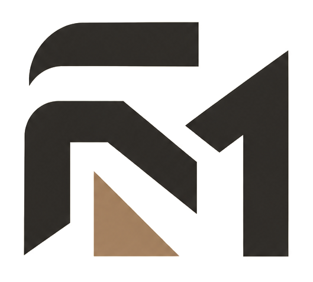

# 🌟 Portfolio Website — Muhammad Faqih Muqoddam

> Junior Web Developer | Siswa RPL SMKN 20 Jakarta

Portfolio website profesional yang menampilkan proyek, keahlian, dan pengalaman dalam pengembangan web.

## 🚀 Live Demo

**Status:** In Development (Local)  
**Planned URL:** TBA

## 📸 Preview



## ✨ Features

- 🎨 **Professional Design** - Clean, minimalist, dan modern
- 🌓 **Dark/Light Mode** - Toggle tema dengan localStorage
- 📱 **Fully Responsive** - Mobile-first design
- ⚡ **Fast Performance** - Optimized CSS & JavaScript
- ♿ **Accessible** - ARIA labels, keyboard navigation, semantic HTML
- 🎯 **Project Showcase** - Modal detail untuk setiap proyek
- 📧 **Contact Form** - Integrasi dengan email client
- 📄 **CV Download** - Download dan preview CV
- 🎓 **Experience Timeline** - Pengalaman dan pendidikan
- 🏆 **Certificates** - Showcase sertifikat dan prestasi

## 🛠️ Tech Stack

**Frontend:**
- HTML5 - Semantic markup
- CSS3 - Custom properties, Flexbox, Grid
- JavaScript (ES6+) - Vanilla JS, no frameworks

**Design:**
- Custom design system
- Professional color palette (#D4A574 accent)
- Typography hierarchy
- Smooth transitions

## 📂 Project Structure

```
portofolio/
├── index.html              # Main HTML file
├── style.css               # All styles
├── script.js               # JavaScript functionality
├── assets/                 # Images and media
│   ├── logo.png
│   ├── Faqih.jpeg         # Profile photo
│   ├── CV.jpg             # Curriculum Vitae
│   ├── project-*.svg      # Project illustrations
│   └── ...
├── magang.pdf             # Internship certificate
├── README.md              # This file
├── UPDATE_LOG.md          # Change log
└── OPTIMASI_CHECKLIST.md  # Optimization checklist
```

## 🎨 Sections

1. **Hero** - Introduction dengan CTA
2. **About** - Background, skills, CV download
3. **Experience** - Timeline pengalaman dan pendidikan
4. **Certificates** - Sertifikat dan prestasi
5. **Technologies** - Tech stack yang dikuasai
6. **Projects** - Portfolio proyek dengan detail modal
7. **Contact** - Form kontak dan social links

## 🚀 Getting Started

### Prerequisites
- Web browser modern (Chrome, Firefox, Safari, Edge)
- Text editor (VSCode, Sublime Text, dll)

### Installation

1. Clone repository:
```bash
git clone https://github.com/faqihanakbaik/portofolio.git
```

2. Navigate to project:
```bash
cd portofolio
```

3. Open in browser:
```bash
# Windows
start index.html

# macOS
open index.html

# Linux
xdg-open index.html
```

Atau gunakan Live Server extension di VS Code.

### Development

Simply edit the files and refresh browser:
- `index.html` - Structure and content
- `style.css` - Styling and layout
- `script.js` - Interactivity and functionality

## 📱 Responsive Breakpoints

- **Desktop:** > 1024px
- **Tablet:** 768px - 1024px
- **Mobile:** < 768px
- **Small Mobile:** < 480px

## ♿ Accessibility

- Semantic HTML5 elements
- ARIA labels and roles
- Keyboard navigation support
- Focus visible states
- Alt text untuk semua images
- High contrast support
- Reduced motion support

## ⚡ Performance

- Minimal JavaScript untuk fast load
- Optimized CSS dengan variables
- Debounced scroll events
- Intersection Observer untuk animations
- Native lazy loading support

## 🎯 Browser Support

- Chrome (latest)
- Firefox (latest)
- Safari (latest)
- Edge (latest)
- Mobile browsers (iOS Safari, Chrome Mobile)

## 📊 Lighthouse Scores (Target)

- Performance: 90+
- Accessibility: 95+
- Best Practices: 95+
- SEO: 90+

## 🔄 Recent Updates

See [UPDATE_LOG.md](UPDATE_LOG.md) for detailed changes.

**Latest:** Redesign Profesional (Oct 18, 2026)
- Mengurangi animasi berlebihan untuk tampilan lebih profesional
- Optimasi performance dan code cleanup
- CV integration dengan tombol download & preview
- Tambah tombol lihat sertifikat magang

## 📝 TODO

See [OPTIMASI_CHECKLIST.md](OPTIMASI_CHECKLIST.md) for full checklist.

**High Priority:**
- [ ] Deploy to hosting (Netlify/Vercel)
- [ ] Custom domain
- [ ] Replace project SVG dengan screenshot
- [ ] Add GitHub repo links
- [ ] Lighthouse audit dan optimization

## 🎓 About Me

Saya adalah siswa kelas XII RPL di SMKN 20 Jakarta yang berfokus pada pengembangan web dan eksplorasi UI/UX. Saya belajar membangun aplikasi menggunakan HTML, CSS, JavaScript, PHP, Laravel, serta teknologi database.

**Pengalaman:**
- Magang di BRIN (1 April – 31 Mei 2026)
- Ketua Kelas & Bendahara Organisasi
- Kepanitiaan 17 Agustus
- Pramuka Garuda

**Projects:**
- Bank Melasa Syariah (HTML, CSS, JavaScript)
- SIMAS Asset Management (Laravel, PostgreSQL)
- EVENTY School Event Management (Laravel, Flutter, Supabase)

## 🤝 Contributing

Portfolio ini adalah proyek personal. Feedback dan saran selalu diterima!

## 📄 License

© 2026 Muhammad Faqih Muqoddam. All rights reserved.

## 📞 Contact

- **Email:** faqihmuqoddam3007@gmail.com
- **GitHub:** [@faqihanakbaik](https://github.com/faqihanakbaik)
- **LinkedIn:** [faqih-muqoddam](https://www.linkedin.com/in/faqih-muqoddam-93a359394/)
- **Instagram:** [@faqiiihhhhhh](https://instagram.com/faqiiihhhhhh)

---

**Made with ❤️ by Muhammad Faqih Muqoddam**
